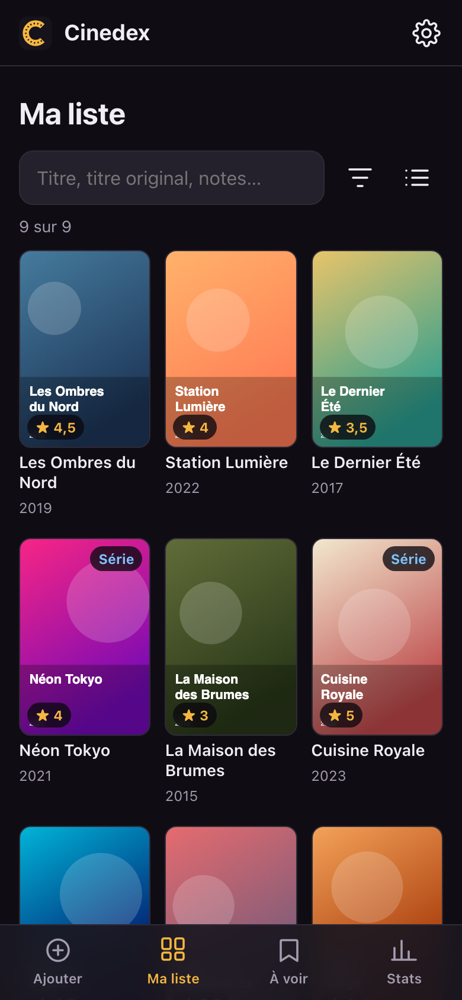
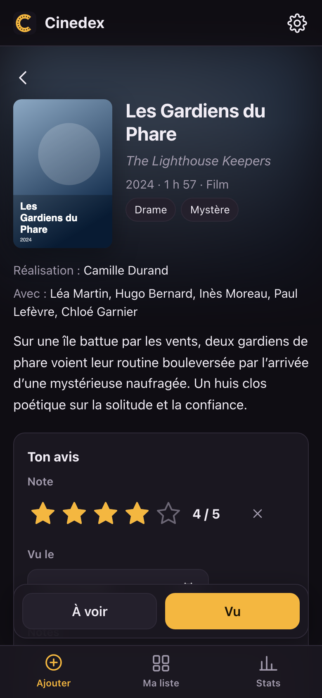
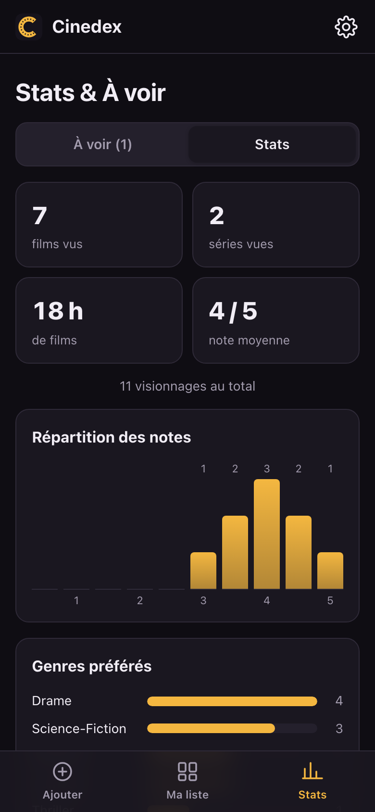

# Cinedex

A small, private, offline-first diary for the movies and TV shows you watch.

- **No backend, no account, no trackers.** Your diary lives in your browser's IndexedDB, on your device.
- **Bring your own TMDB key.** The only network calls go from your device to the TMDB API and its image server.
- **Installable PWA.** Works offline for browsing your list; only adding a title needs the network.
- **Bilingual UI** (French by default, English), dark theme by default, light and auto themes available.

<p align="center">
  
  
  
</p>

<sub>Screenshots use fictional titles and generated posters.</sub>

## Features

- **Add**: search movies and TV shows as you type (TMDB `search/multi`), open a detail sheet
  (poster, localized and original title, year, runtime or seasons, TMDB community score, genres,
  director or creators, main cast, synopsis with English fallback), then save it as **Watched** or **Watchlist**
  with a half-star rating, notes, free tags and a watch date. TV shows get a light progress
  tracker: status (watching / finished / dropped) and last season watched.
- **My list** (home screen): poster grid or compact list, text search (local title, original title, notes),
  sort (watch date, rating, title, release year) and filters (type, genre, tag, minimum rating).
  Open an entry to edit it (changes are saved automatically), log a rewatch or delete it.
- **People**: tap a director, creator or actor to see their filmography. It comes from the person's
  TMDB credits (by id), so a namesake title never shows up.
- **Watchlist**: titles to watch as a checklist (tick a title once watched, with undo).
- **Stats**: counts, hours of movies,
  average rating, rating distribution, top genres, viewings per month and per year.
- **Backup**: export to JSON (complete) or CSV (simplified), sent through the Android share sheet
  (Drive, Nextcloud, email…) when available; import a JSON export (merge).
- **Share a title**: the share button on any sheet sends a link to that title. Recipients who use
  Cinedex get the full sheet (in the installed app when their browser opens links in it); others
  get a preview card with the poster and a link to TMDB.
- **Share to Cinedex** (Android, app installed from Chrome): share a TMDB or IMDb link to Cinedex
  to open its detail sheet directly.

Posters are downloaded once (`w342`) when you add a title and stored in IndexedDB:
browsing your list never hits the network.

## Getting started

### 1. Get a TMDB API key

1. Create a free account on [themoviedb.org](https://www.themoviedb.org/signup).
2. Go to **Settings → API** ([direct link](https://www.themoviedb.org/settings/api)) and request
   an API key (type "Developer", personal use). The form asks for a short description and a URL:
   any honest answer works for personal use.
3. Copy either the **API Read Access Token** (v4, recommended, a long string starting with `eyJ`)
   or the **API Key** (v3, 32 characters). Cinedex accepts both.
4. In Cinedex, open **Settings** (gear icon) → paste the key → **Save & test**.

The key is stored only on your device and sent only to `api.themoviedb.org`.

### 2. Install the app

Open the Cinedex URL (for example `https://<user>.github.io/cinedex/`) and:

- **Android, Chrome**: menu ⋮ → **Install app**. Cinedex shows up in the app drawer like a regular app
  and can receive shared links.
- **Android, other browsers** (Brave, Firefox…): menu → **Add to home screen**. Works the same,
  but the icon carries the browser's badge and sharing links to Cinedex isn't available.
- **iPhone / iPad, Safari**: Share → **Add to Home Screen**.
- **Desktop, Chrome / Edge**: the install icon in the address bar.

Your data belongs to the browser you installed from: an entry added in Brave isn't visible in Chrome.
Use export / import to move it.

Updates are automatic: when a new version is published, the app offers to reload.

## Backup format

**JSON** (complete, re-importable). Stable, indented with 2 spaces, versioned with `schemaVersion`:

```json
{
  "app": "cinedex",
  "schemaVersion": 1,
  "exportedAt": "2026-11-13T21:00:00.000Z",
  "items": [{
    "id": "movie:603",
    "tmdbId": 603, "type": "movie", "imdbId": "tt0133093",
    "title": "Matrix", "originalTitle": "The Matrix", "year": 1999,
    "runtime": 136, "seasons": null,
    "genres": ["Action", "Science-Fiction"],
    "directors": ["Lana Wachowski", "Lilly Wachowski"],
    "cast": ["Keanu Reeves", "Laurence Fishburne"],
    "overview": "…", "posterPath": "/abc.jpg", "metaLang": "fr-FR",
    "status": "watched",
    "rating": 4.5, "notes": "…", "tags": ["ciné"],
    "watches": ["2026-11-13"],
    "seriesStatus": null, "lastSeason": null,
    "createdAt": "2026-11-13T21:00:00.000Z", "updatedAt": "2026-11-13T21:00:00.000Z"
  }]
}
```

| Field | Meaning |
| --- | --- |
| `id` | `movie:<tmdbId>` or `tv:<tmdbId>`, unique key used for merging |
| `type` | `movie` or `tv` |
| `status` | `watched` or `watchlist` |
| `rating` | 0.5 to 5 in half points, or `null` |
| `watches` | watch dates (`YYYY-MM-DD`), one per viewing, sorted |
| `seriesStatus` | TV only: `watching`, `finished`, `dropped` (or `null`) |
| `lastSeason` | TV only: last season watched (or `null`) |
| `metaLang` | language of the TMDB metadata (`fr-FR` / `en-US`) |
| `runtime` | minutes (movies); `seasons`: number of seasons (TV) |

**Import** merges by `id`: when both sides have an entry, the one with the most recent `updatedAt` wins.
Posters aren't part of the export; they are downloaded again after the import.

**CSV** (simplified, for spreadsheets): type, titles, year, status, rating, watch dates, tags, notes,
genres, directors, series progress and ids. Lists are joined with `; `. Not re-importable.

## Development

No build step, no dependencies: plain ES modules served as static files.

```sh
python3 -m http.server 8000
# then open http://localhost:8000
```

- The service worker caches the app shell: in DevTools → Application → Service Workers,
  tick **Update on reload** while developing.
- On each release, bump `CACHE_VERSION` in `sw.js` and `APP_VERSION` in `js/version.js`
  (and list any new file in `SHELL`).
- A strict Content-Security-Policy in `index.html` only allows `api.themoviedb.org` and `image.tmdb.org`.

Code map:

| Path | Role |
| --- | --- |
| `js/app.js` | startup, hash router, service worker registration |
| `js/db.js`, `js/items.js`, `js/posters.js` | IndexedDB, entries, poster Blobs |
| `js/tmdb.js` | TMDB client (v3 key or v4 token) |
| `js/backup.js`, `js/share.js` | export / import, title links and share target |
| `js/views/` | Add, detail sheet, My list, entry editor, person page, Stats, Settings |
| `sw.js` | offline app shell |

### Deploy your own copy

Fork the repository, then in **Settings → Pages** set **Source: GitHub Actions**.
Every push to `main` publishes the site with the workflow in `.github/workflows/pages.yml`.
GitHub Pages on a free plan requires a public repository.

## Credits


This product uses the TMDB API but is not endorsed or certified by TMDB.

## License

[MIT](LICENSE)
